# AI 应用创意工坊（AI Creative Workshop）

> 一句话描述需求，AI 流式生成可运行的网站应用；支持实时预览、对话式修改、一键部署与截图封面。

一个「AI 零代码应用生成平台」的完整实现：**单体后端 + 微服务后端 + 前端** 三套代码放在同一个仓库里，既可以按单体方式快速跑起来，也可以按微服务方式拆分部署。

<p align="left">
  
  
  
  
  
</p>

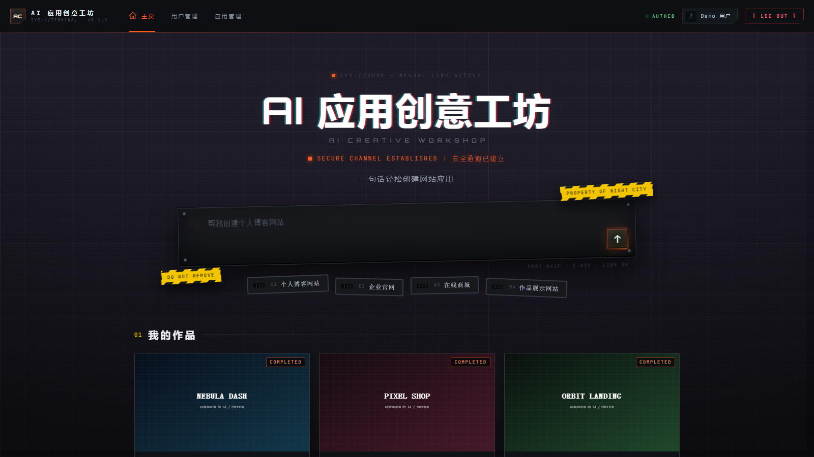

---

## 目录

- [项目简介](#项目简介)
- [功能特性](#功能特性)
- [界面预览](#界面预览)
- [技术栈](#技术栈)
- [系统架构](#系统架构)
- [项目结构](#项目结构)
- [快速开始](#快速开始)
- [配置说明](#配置说明)
- [核心实现](#核心实现)
- [接口文档](#接口文档)
- [部署说明](#部署说明)
- [常见问题](#常见问题)

---

## 项目简介

传统做网站要写代码，这个项目把「描述需求 → 生成代码 → 预览 → 修改 → 部署」压缩成一条对话流：

1. 在首页输入一句需求（例如「做一个赛博朋克风格的个人主页」）；
2. 平台用**小模型做意图路由**，自动判断该生成原生 HTML、多文件（HTML + CSS + JS）还是 Vue 工程；
3. 大模型以 **SSE 流式**返回代码，前端边收边渲染；
4. 后端把代码块解析出来落盘到 `tmp/code_output`，前端用 iframe 实时预览；
5. 不满意就继续对话修改，或者开启「可视化编辑」直接点选页面元素让 AI 改；
6. 满意后一键部署到 `tmp/code_deploy`，由 Nginx 托管，同时用 Selenium 截图生成封面。

## 功能特性

### 应用模块

| 功能 | 说明 |
| --- | --- |
| 创建应用 | 输入初始需求即可创建，自动绑定生成类型 |
| 我的应用 | 分页查询、卡片式展示（含生成中/失败/已完成三态） |
| 精选应用 | 管理员标记后首页展示，Redis 分页缓存 |
| 应用详情 | 名称、封面、生成类型、部署地址、创建时间 |
| 实时预览 | iframe 直接加载生成结果，支持新窗口打开 |
| 可视化编辑 | 点选 iframe 中的元素，把选择器与文本交给 AI 修改 |
| 一键部署 | 复制产物到部署目录，返回可访问地址 |
| 封面生成 | Selenium 无头浏览器截图并上传腾讯云 COS |
| 代码下载 | 产物打包成 zip 下载 |
| 管理功能 | 管理员可管理全部应用、设置/取消精选、删除 |

### 对话历史模块

| 功能 | 说明 |
| --- | --- |
| 双写记录 | 用户消息与 AI 回复逐条落库 |
| 游标分页 | 以 `lastCreateTime` 为游标加载更多，避免深分页 |
| 多轮记忆 | Redis 持久化 `ChatMemory`，按 `appId` 隔离 |
| 记忆 TTL | 会话记忆 1 小时过期，自动清理 |
| 历史加载 | 进入对话页自动拉取最近 10 条并支持上翻 |

### AI 代码生成模块

| 功能 | 说明 |
| --- | --- |
| 原生 HTML 模式 | 单文件输出，适合简单落地页 |
| 原生多文件模式 | HTML + CSS + JS 三块输出，缺块自动补全 |
| Vue 工程模式 | 生成完整 Vue 项目并执行 `npm install && npm run build` |
| 智能路由 | 小模型（qwen）只回答 0/1/2，决定生成类型 |
| 流式生成 | `Flux` + SSE，逐块推送到浏览器 |
| 代码解析 | 正则解析 Markdown 代码块，兼容未闭合围栏 |
| 文件保存 | 模板方法模式，按类型落盘并做路径校验 |
| 输入护栏 | Prompt 安全检查，超长输入拦截 |
| 输出护栏 | 敏感内容重试 |

### 用户模块

| 功能 | 说明 |
| --- | --- |
| 注册 / 登录 / 注销 | Session + Redis 共享会话 |
| 当前用户 | 登录态查询，未登录返回空 |
| 权限控制 | 注解 + AOP 校验管理员角色 |
| 用户管理 | 管理员分页查询、删除用户 |

### 系统优化

| 方向 | 落地方式 |
| --- | --- |
| 性能 | Caffeine 缓存 AI 服务实例、Redis 页面缓存、数据库索引、虚拟线程处理截图 |
| 安全 | 输入护栏、路径穿越校验、权限拦截、限流 |
| 流量保护 | `@RateLimit` + Redisson，按用户 5 次/60 秒 |
| 成本 | 意图路由使用小模型、限制 `max-tokens` |
| 稳定性 | 超时与重试、缺块补全、异常降级、SSE 断线处理 |
| 可观测 | Micrometer 指标（请求数/错误数/Token/耗时）+ Prometheus |

## 界面预览

| 登录（身份核验终端） | 注册 |
| --- | --- |
| 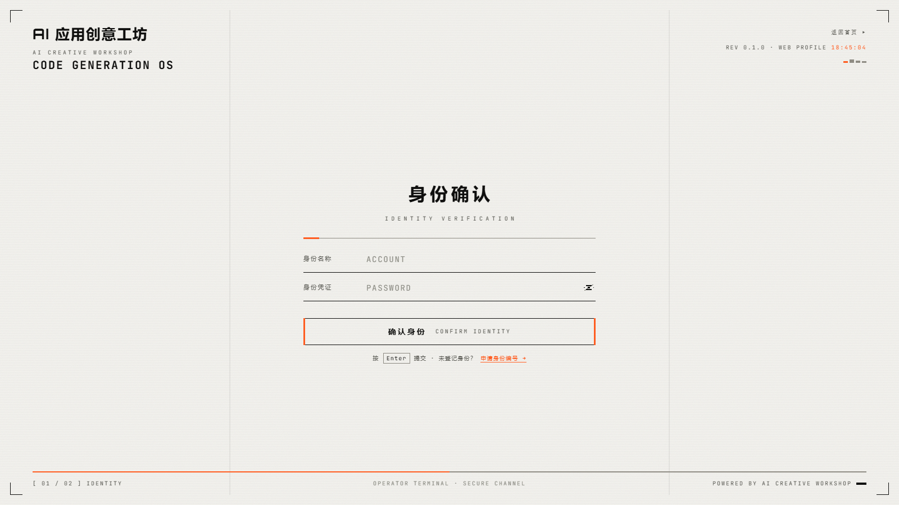 | 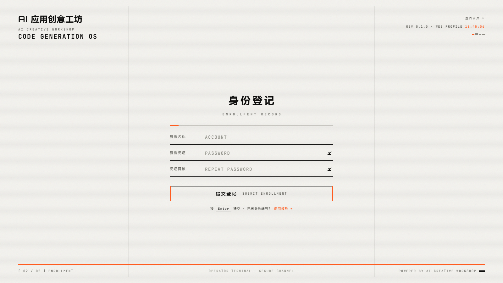 |

| 我的作品（三态卡片） | 对话生成 |
| --- | --- |
| 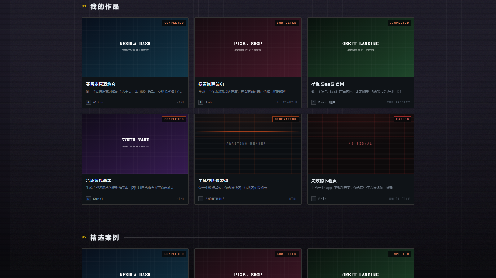 | 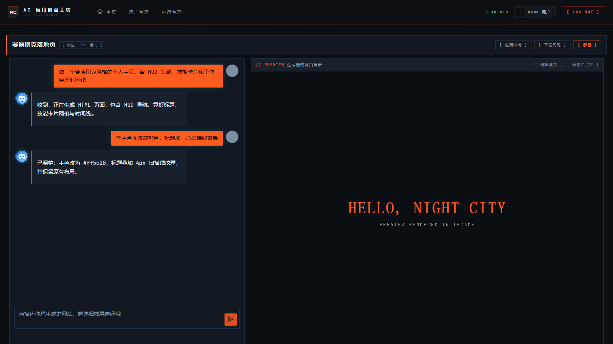 |

| 编辑应用 | 应用管理 |
| --- | --- |
| 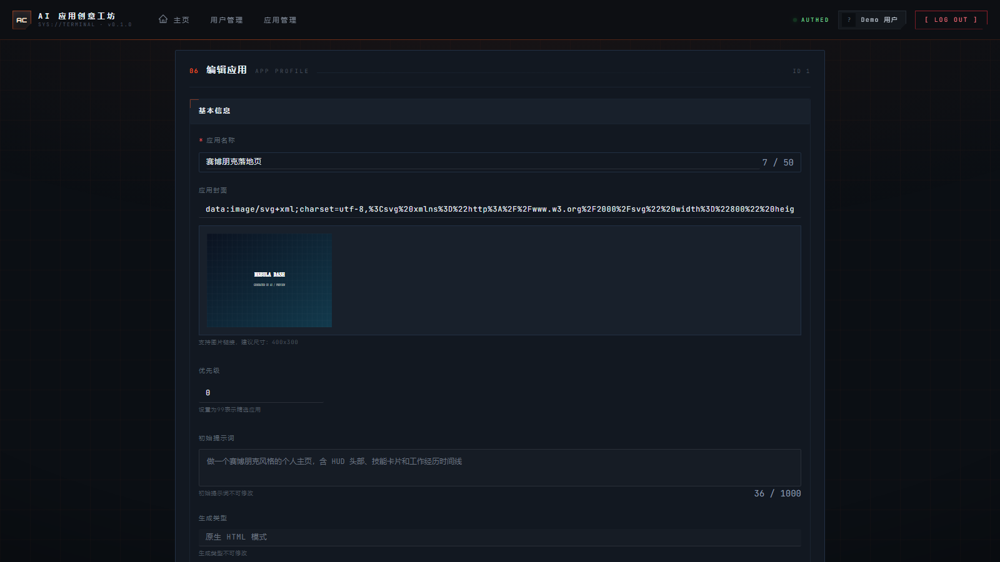 | 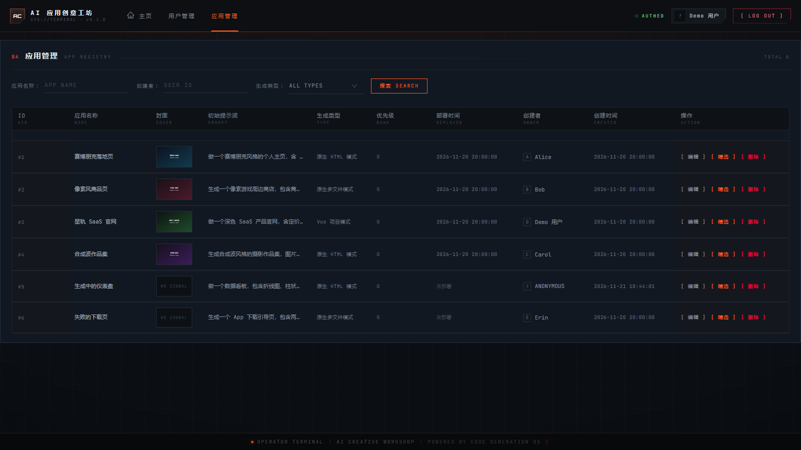 |

| 用户管理 | 对话管理 |
| --- | --- |
| 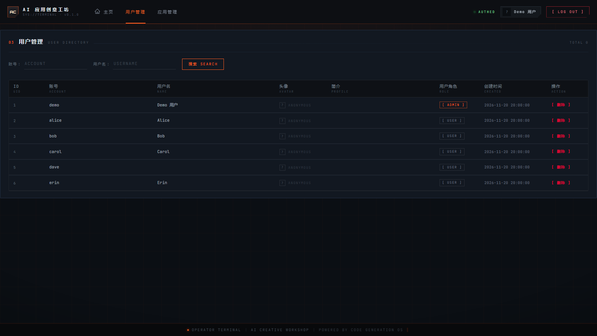 | 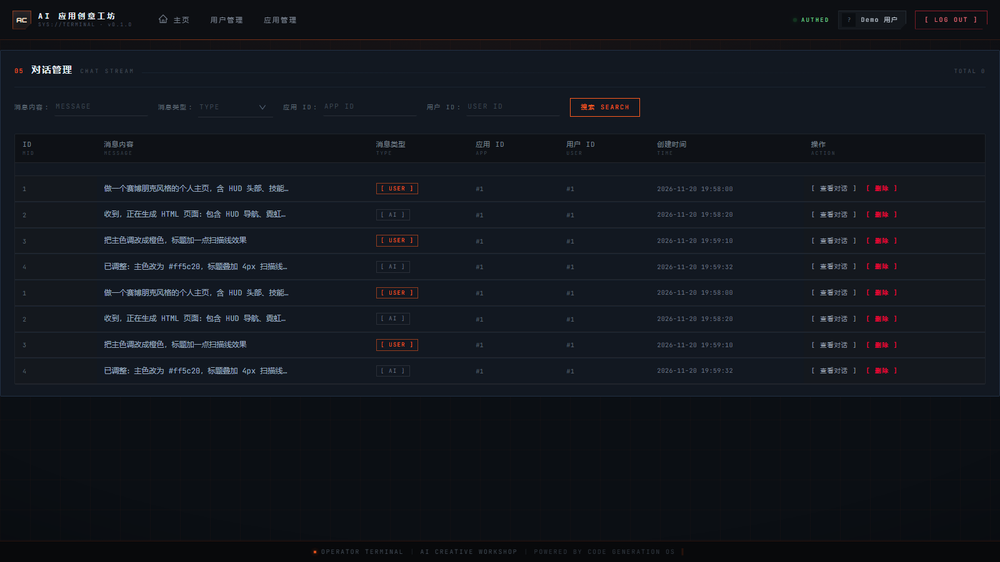 |

> 界面采用「极简企业赛博朋克」：深色底 + 橙色强调 `#ff5c20` + 等宽终端字体 + 1px 边框与切角，全站零大圆角、零柔和阴影。

## 技术栈

**后端（单体 / 微服务）**

- Java 21、Spring Boot 3.5、Maven
- MyBatis-Flex、MySQL 8、Redis、Caffeine
- LangChain4j 1.1（OpenAI 兼容协议，接入 DeepSeek / 通义千问）
- LangGraph4j（工作流编排）
- Dubbo 3.3 + Nacos（微服务版）
- Selenium 4（无头截图）、腾讯云 COS（对象存储）
- Knife4j（OpenAPI 3 文档）、Micrometer + Prometheus

**前端**

- Vue 3.5 + TypeScript + Vite 7
- Ant Design Vue 4 + Pinia + Vue Router
- Markdown-it + highlight.js（代码高亮）
- OpenAPI 自动生成请求代码（openapi2ts）
- SSE（EventSource）流式渲染

## 系统架构

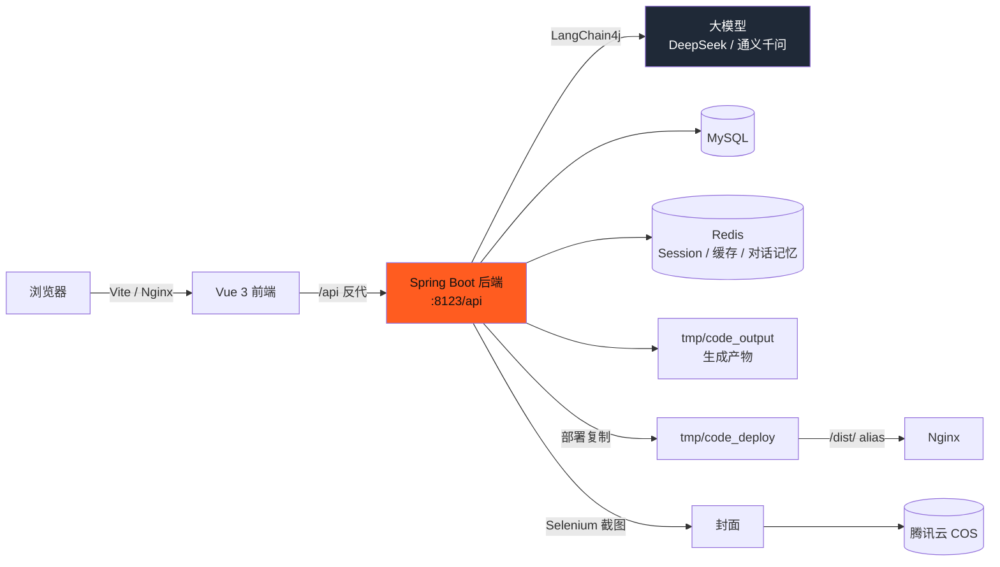

微服务版把「用户 / 应用 / 截图」拆成三个服务，通过 Dubbo（triple 协议）调用，注册到 Nacos：

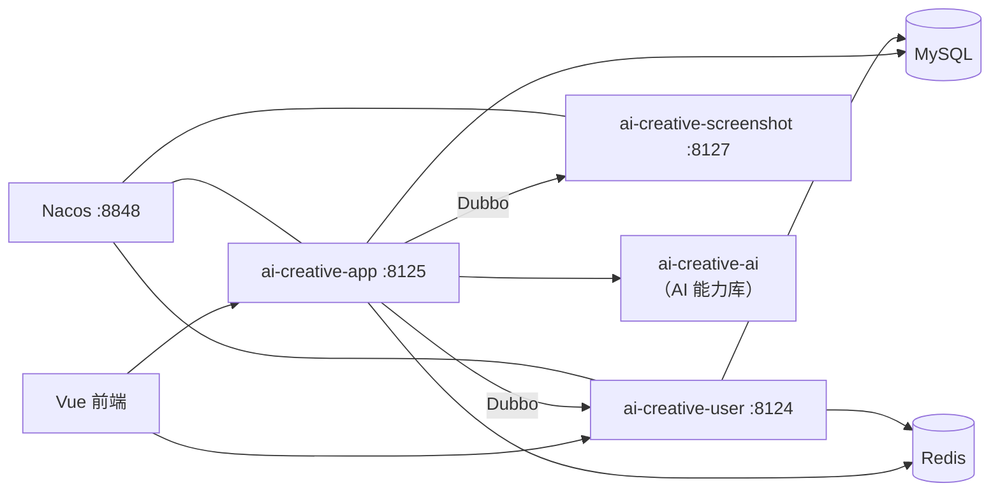

## 项目结构

```
ai-create-workshop/
├── backend/                     # 单体后端（开箱即用）
│   ├── src/main/java/com/hsq/aicreativeworkshop/
│   │   ├── ai/                  # AiService 接口、生成类型路由、护栏
│   │   ├── config/              # 模型、COS、Redis、缓存配置
│   │   ├── controller/          # App / 对话历史 / 用户 / 静态资源 / 工作流
│   │   ├── core/                # 生成门面、解析器、保存器、Vue 构建
│   │   ├── langgraph4j/         # 工作流编排（节点、状态、工具）
│   │   ├── monitor/             # Micrometer 指标
│   │   └── service/             # 业务实现
│   ├── src/main/resources/
│   │   ├── application.yml      # 主配置（已脱敏，用环境变量注入）
│   │   ├── application-sample.yml
│   │   └── prompt/              # 提示词模板
│   ├── sql/create_base_table.sql
│   ├── grafana/                 # Grafana 看板配置
│   └── prometheus.yml
├── microservice/                # 微服务版（7 模块）
│   ├── ai-creative-common/      # 公共常量、异常、工具、COS
│   ├── ai-creative-model/       # 实体、DTO、VO、枚举
│   ├── ai-creative-client/      # Dubbo 接口契约
│   ├── ai-creative-ai/          # AI 能力库（模型、护栏、工具、提示词）
│   ├── ai-creative-user/        # 用户服务 :8124
│   ├── ai-creative-app/         # 应用服务 :8125
│   └── ai-creative-screenshot/  # 截图服务 :8127
├── frontend/                    # Vue 3 前端
│   ├── src/pages/               # 首页 / 对话 / 编辑 / 后台
│   ├── src/components/          # 卡片、终端分页、转场、页头页脚
│   ├── src/styles/              # tokens.css / cyberpunk.css / auth.css
│   └── src/theme/antdTheme.ts   # Ant Design 主题
└── docs/screenshots/            # README 截图
```

## 快速开始

### 环境要求

| 依赖 | 版本 |
| --- | --- |
| JDK | 21 |
| Maven | 3.9+ |
| MySQL | 8.0+ |
| Redis | 6+ |
| Node.js | 18+（推荐 20/22） |
| Nacos | 2.x（仅微服务需要） |

### 1. 初始化数据库

```bash
mysql -uroot -p -e "CREATE DATABASE ai_creative_workshop DEFAULT CHARSET utf8mb4;"
mysql -uroot -p ai_creative_workshop < backend/sql/create_base_table.sql
```

### 2. 配置密钥

所有敏感配置都改成了环境变量占位，启动前设置（或直接修改 `application.yml` 里的默认值）：

```bash
# Windows PowerShell
$env:DEEPSEEK_API_KEY="sk-xxx"
$env:DASHSCOPE_API_KEY="sk-xxx"
$env:PEXELS_API_KEY="xxx"
$env:COS_SECRET_ID="xxx"
$env:COS_SECRET_KEY="xxx"
$env:MYSQL_PASSWORD="123456"
```

```bash
# macOS / Linux
export DEEPSEEK_API_KEY=sk-xxx
export DASHSCOPE_API_KEY=sk-xxx
export PEXELS_API_KEY=xxx
export COS_SECRET_ID=xxx
export COS_SECRET_KEY=xxx
export MYSQL_PASSWORD=123456
```

> 只跑「原生 HTML / 多文件」模式的话，只需要 `DEEPSEEK_API_KEY`；三元路由需要 `DASHSCOPE_API_KEY`，否则无法自动判断类型。

### 3. 启动单体后端

```bash
cd backend
mvn spring-boot:run
```

启动后：

- 接口地址：<http://localhost:8123/api>
- 接口文档：<http://localhost:8123/api/doc.html>

### 4. 启动前端

```bash
cd frontend
npm install
npm run dev
```

打开 <http://localhost:5173>，Vite 已把 `/api` 代理到 `8123`。

### 5. （可选）启动微服务版

```bash
# 先启动 Nacos、MySQL、Redis
cd microservice
mvn clean install -DskipTests

# 三个服务分别启动（IDEA 里直接运行启动类也可以）
mvn -pl ai-creative-user      spring-boot:run
mvn -pl ai-creative-app       spring-boot:run
mvn -pl ai-creative-screenshot spring-boot:run
```

微服务端口：用户 `8124`、应用 `8125`、截图 `8127`；Dubbo 端口 `50051/50052/50053`。
前端切到微服务时，把 `vite.config.ts` 的代理目标改成对应端口，或按环境变量配置多目标代理。

## 配置说明

### 后端关键配置（`backend/src/main/resources/application.yml`）

| 配置项 | 默认值 | 说明 |
| --- | --- | --- |
| `server.port` | `8123` | 服务端口 |
| `server.servlet.context-path` | `/api` | 统一前缀 |
| `spring.datasource.url` | `jdbc:mysql://localhost:3306/ai_creative_workshop` | 数据库 |
| `spring.data.redis.database` | `1` | Redis 库号 |
| `langchain4j.open-ai.chat-model.api-key` | `${DEEPSEEK_API_KEY:}` | 对话模型密钥 |
| `langchain4j.open-ai.routing-chat-model` | dashscope | 意图路由小模型 |
| `code.deploy-host` | `http://localhost` | 部署产物访问前缀（配合 Nginx） |
| `cos.client.*` | `${COS_SECRET_ID:}` 等 | 腾讯云对象存储 |

### 前端配置

| 变量 | 位置 | 说明 |
| --- | --- | --- |
| `VITE_API_BASE_URL` | `.env.development` | 请求前缀，默认 `/api` |
| `VITE_DEPLOY_DOMAIN` | `.env.development` | 部署产物域名，默认 `http://localhost` |
| `VITE_PROXY_APP` / `VITE_PROXY_USER` | 可选 | 微服务模式下分别指向 `8125` / `8124` |

## 核心实现

### 1. 三种生成模式与智能路由

`AiCodeGenTypeRoutingService` 让小模型只回答一个数字（0=HTML、1=多文件、2=Vue），把「选型」这件事的成本压到几百 token。选型结果决定后续走哪条 `AiCodeGeneratorService` 方法和哪套解析器/保存器。

### 2. SSE 流式生成

Controller 返回 `Flux<ServerSentEvent<String>>`，每个 chunk 包成 `{"d": "..."}` 的 SSE 帧；前端用 `EventSource` 接收并逐块追加，结束后由 `done` 事件触发刷新。相比 WebSocket，SSE 单向、天然支持断线重连、可直接穿过 Nginx（需要关闭 `proxy_buffering`）。

### 3. 解析器 → 保存器（模板方法 + 策略）

```
AiCodeGeneratorFacade
  └─ CodeParserExecutor  → HtmlCodeParser / MultiFileCodeParser
       └─ CodeFileSaverExecutor → HtmlCodeFileSaverTemplate / MultiFileCodeFileSaverTemplate
```

解析器只负责「把 Markdown 代码块变成对象」，保存器只负责「把对象写进目录」，两者都能单独替换与测试。

### 4. 缺块自动补全

模型偶尔只输出 HTML 块。门面在流结束后先探一次块，缺任意一块就再发一次**流式**补全请求（只补 CSS/JS），合并后再保存；补全失败则降级按首次结果保存，保证「至少能存下能跑的部分」。

### 5. Vue 工程构建

`VueProjectBuilder` 用 `ProcessBuilder` 在产物目录执行 `npm install` 与 `npm run build`，把 `dist` 作为预览根；构建失败会把日志写进对话消息，方便定位。

### 6. 部署与封面

部署 = 把 `tmp/code_output/{type}_{appId}` 复制到 `tmp/code_deploy/{deployKey}`，再返回 `{deployHost}/{deployKey}/`；Nginx 用 `location /dist/ { alias ...; }` 托管该目录。截图用 Selenium 打开同一地址，上传 COS 后回写封面。

### 7. 微服务拆分

| 模块 | 职责 |
| --- | --- |
| `ai-creative-ai` | AI 能力库：模型配置、护栏、工具、提示词（无启动类） |
| `ai-creative-app` | 应用与对话：生成、解析、保存、部署、限流 |
| `ai-creative-user` | 用户与登录态 |
| `ai-creative-screenshot` | Selenium 截图 + COS 上传 |

服务间通过 `ai-creative-client` 中的接口以 Dubbo triple 调用，Session 存 Redis 共享。

## 接口文档

启动后端后访问 Knife4j：<http://localhost:8123/api/doc.html>

主要分组：

- `AppController`：应用增删改查、分页、精选、部署、下载、SSE 生成
- `ChatHistoryController`：按应用游标分页、管理员分页
- `UserController`：注册、登录、注销、当前用户、管理
- `StaticResourceController`：生成产物预览
- `WorkflowSseController`：LangGraph4j 工作流（实验性）

## 部署说明

生产环境推荐「Nginx + 后端 jar + 前端静态文件」：

```nginx
server {
    listen 80;
    server_name your-domain.com;

    # 前端
    location / {
        root /var/www/ai-creative-workshop/dist;
        try_files $uri $uri/ /index.html;
    }

    # 后端 API（SSE 必须关闭缓冲）
    location /api/ {
        proxy_pass http://127.0.0.1:8123;
        proxy_http_version 1.1;
        proxy_set_header Connection "";
        proxy_buffering off;
        proxy_cache off;
        gzip off;
        proxy_read_timeout 600s;
    }

    # 部署产物
    location /dist/ {
        alias /opt/ai-creative-workshop/tmp/code_deploy/;
        index index.html;
    }
}
```

同时把 `application.yml` 的 `code.deploy-host` 改成 `http://your-domain.com/dist`，前端 `.env.production` 的 `VITE_DEPLOY_DOMAIN` 改成同一地址。

## 常见问题

**Q：部署后访问 `/dist/xxx/` 是 404？**
A：三件事按顺序检查：① `code.deploy-host` 是否配置且与 Nginx 的 `location` 前缀一致；② Nginx 是否真的加载了这段配置（`nginx -t` + `-s reload`）；③ `tmp/code_deploy/{deployKey}` 目录是否生成。

**Q：生成很慢或中途断流？**
A：SSE 链路要关掉 `proxy_buffering`、`gzip` 和短超时；直连后端（不经代理）能排除代理因素。

**Q：模型只输出一个 HTML 块？**
A：这是模型对「多代码块」的遵守度问题，平台侧已做缺块补全兜底；也可以在提示词里强化约束或换更强的模型。

**Q：微服务启动报 `No provider available`？**
A：先确认 Nacos 已启动、三个服务的 `dubbo.application.name` 都已配置、消费者开启 `check=false`。

**Q：前端 401 一直跳登录？**
A：Session 存在 Redis 里，前后端要指向同一个 Redis 库；跨域时需 `withCredentials` 且后端允许携带 Cookie。

---

## 说明

- 仓库内的密钥与数据库口令均已替换为 `${ENV:默认值}` 形式，克隆后请自行配置；
- 生成的网站代码保存在 `tmp/` 下，已被 `.gitignore` 排除；
- 本项目用于学习与技术演示，生成的代码请自行审查后再上线。